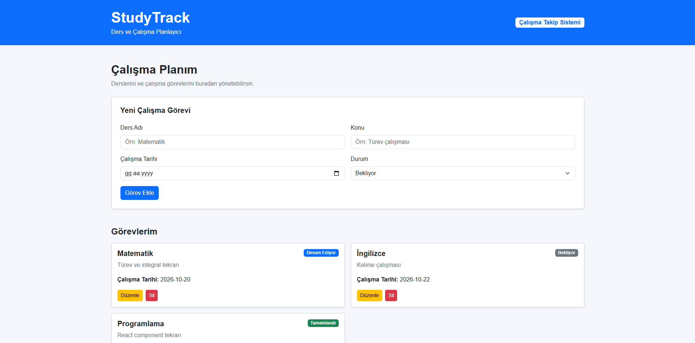

# StudyTrack
## Canlı Demo

StudyTrack uygulamasının canlı sürümüne aşağıdaki bağlantıdan ulaşabilirsiniz:

https://splendid-kringle-f4d5f2.netlify.app

StudyTrack, öğrencilerin derslerini ve çalışma görevlerini kolay bir şekilde planlayıp takip edebilmesi için geliştirilmiş bir React uygulamasıdır.

Uygulama üzerinden yeni çalışma görevleri eklenebilir, mevcut görevler listelenebilir, güncellenebilir ve silinebilir. Görevler LocalStorage üzerinde saklandığı için sayfa yenilendiğinde veriler kaybolmaz.

## Özellikler

- Yeni çalışma görevi ekleme
- Çalışma görevlerini listeleme
- Mevcut görevleri güncelleme
- Görev silme
- Görev durumlarını takip etme
- LocalStorage ile veri saklama
- Responsive Bootstrap 5 tasarımı

## Kullanılan Teknolojiler

- React
- JavaScript
- Vite
- Bootstrap 5
- HTML5
- CSS3
- LocalStorage

## Görev Durumları

StudyTrack içerisinde görevler üç farklı durumda takip edilebilir:

- Bekliyor
- Devam Ediyor
- Tamamlandı

Görev durumları uygulama içerisinde farklı renklerde rozetler ile gösterilmektedir.

## Kurulum

Projeyi bilgisayarınızda çalıştırmak için:

```bash
npm install
```

Ardından geliştirme sunucusunu başlatın:

```bash
npm run dev
```

Production sürümünü oluşturmak için:

```bash
npm run build
```

## Proje Ekran Görüntüsü



## Proje Yapısı

```text
studytrack/
├── public/
├── screenshots/
│   └── studytrack-home.png
├── src/
│   ├── components/
│   │   ├── Header.jsx
│   │   └── StudyForm.jsx
│   ├── pages/
│   ├── App.css
│   ├── App.jsx
│   ├── index.css
│   └── main.jsx
├── package.json
└── README.md
```

## Geliştirici

Taha Neccaroğlu